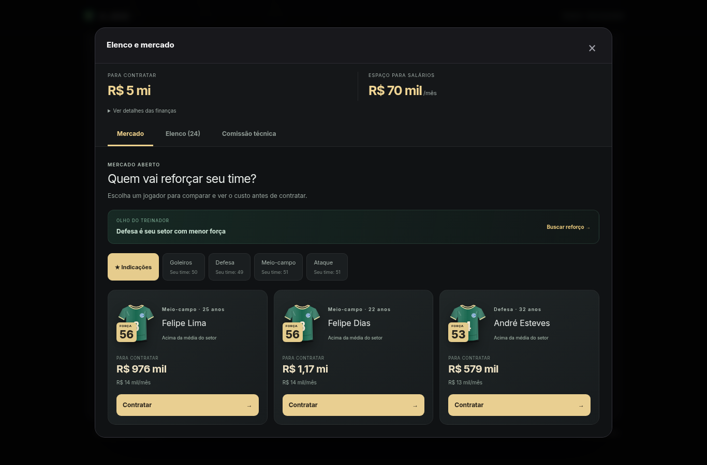
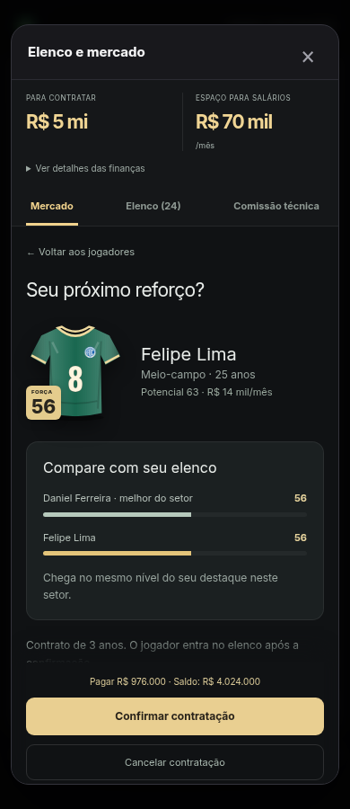

# Mercado guiado — proposta implementada

Remodelação solicitada após o usuário considerar o mercado pouco interativo e as informações confusas. Publicada em 04/11/2026 no commit `b8667e3`, após autorização do usuário. O deploy do GitHub Pages e as duas validações automáticas concluíram com sucesso. Endereço: https://bravolucas.github.io/A-Joia/.

## Fluxo de jogo

1. **Escolher o reforço.** A abertura mostra três indicações em cartões com camisa, força, idade, preço e salário. As indicações priorizam negócios possíveis e jogadores acima da média do setor. O botão de sugestão aponta para o setor mais fraco; filtros de posição permitem procurar outros jogadores.
2. **Comparar e decidir.** Clicar em Contratar abre uma proposta com comparação visual contra o melhor jogador do setor. Ela informa custo, saldo final, espaço salarial restante e força do elenco antes/depois. Abrir ou cancelar a proposta não altera o save.
3. **Confirmar.** O resumo do pagamento e os botões ficam visíveis no rodapé durante a rolagem. Só a confirmação efetiva a compra. O recibo permite ir diretamente ao setor do novo jogador.
4. **Organizar o elenco.** A aba Elenco mostra uma posição por vez. Vender abre a previsão de receita, salário liberado e força resultante; renovação tem seu próprio resumo de contrato e luvas.

## Informação organizada

- Dinheiro para contratar e espaço para salários permanecem no topo da janela.
- Valores resumidos nos cartões; confirmação usa os valores exatos em reais.
- Detalhes financeiros completos ficam em uma seção expansível.
- Propostas sem orçamento ou salário disponível explicam o bloqueio e desabilitam a confirmação. Vendas que esvaziariam um setor também são bloqueadas com uma explicação.
- Comissão técnica usa os mesmos cartões e a mesma etapa de confirmação, com prazo e custo antecipado informados.
- O desktop tem uma janela mais larga com três cartões por linha; o celular usa um cartão por linha e rolagem interna. Teclado, retorno de foco e preferência por movimento reduzido foram preservados.

## Prévias reais da aplicação

## Verificação

- 23 arquivos de testes de lógica e build de produção aprovados.
- 50 testes de navegador passaram na verificação final.
- Os testes verificam compra com confirmação, cancelamento sem débito, recibo, foco, venda, renovação, comissão, falta de dinheiro, limite salarial e preservação do setor mínimo, em celular e desktop.
- A verificação visual identificou e corrigiu uma regra de largura antiga que comprimia os cartões no desktop. Há uma asserção de largura para proteger esse caso.

As regras econômicas, cálculos de força e formato dos saves são os existentes. A previsão usa as mesmas funções de negociação, com objetos independentes, e só salva o negócio após a confirmação.
