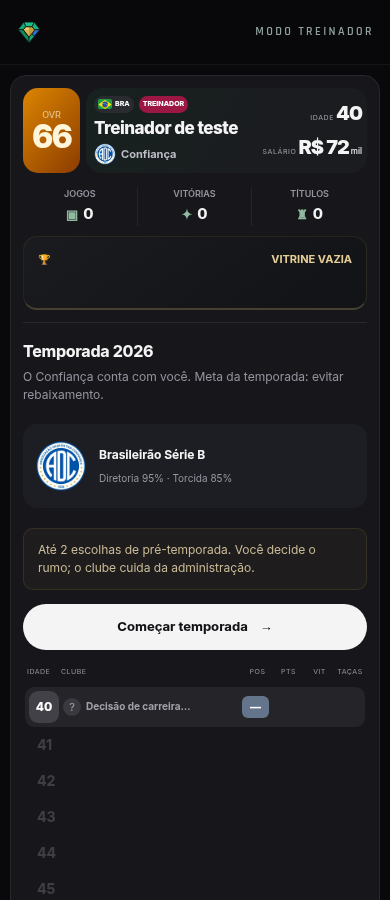
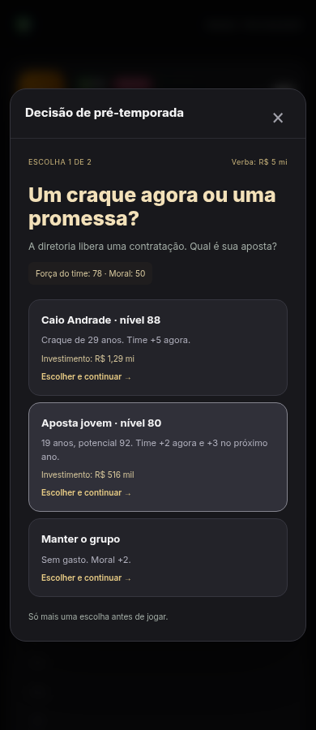

# Treinador rápido — escolhas e simulação

Revisão solicitada pelo usuário: abandonar a administração de elenco e comissão e priorizar uma ou, no máximo, duas decisões que influenciem a temporada.

## Fluxo implementado

Escolher/continuar no clube → Começar temporada → uma decisão (normal/expresso) ou duas (intenso) → simulação automática → resultado e propostas de trabalho. O botão de começar aparece antes do histórico no celular.

Não há acesso a elenco, compra/venda individual, comissão ou seletores de tática no fluxo atual. O esquema aparece como uma escolha contextual. Os dados antigos foram preservados para compatibilidade; a gestão escondida não envelhece o elenco nem aplica comissão à nova carreira rápida. Saves antigos já com jogos/intervenção pendentes são concluídos sem repetir resultados.

## Variações

| Carta | Exemplos de escolhas |
| --- | --- |
| Craque ou promessa | Jogador fictício com nome e nível, impacto imediato ou evolução no próximo ano |
| Esquema | 4-3-3 ofensivo, 3-5-2 defensivo ou 4-4-2 equilibrado |
| Venda da base | Receita imediata com perda de força ou manter e desenvolver o jovem |
| Reforço do rival | Nome, nível e rival local coerente; ganho em campo e reação do vestiário |
| Veterano | Força imediata e desgaste futuro ou oportunidade para a base |
| Preparação | Intensidade e custo ou descanso e moral |
| Capitão | Renovar liderança ou confiar no experiente |
| Diretoria | Mais verba e cobrança ou autonomia |
| Empréstimo | Reforço por uma temporada com perda do bônus no ano seguinte |
| Renovação | Manter o destaque ou negociar a saída para fazer caixa |

As quatro cartas mais recentes são evitadas. A escolha disponível é estável antes de responder e entre recargas. A primeira resposta do modo intenso é salva; a segunda retoma do ponto correto. Respostas duplicadas não gastam novamente nem simulam outro ano.

Força, moral, torcida, diretoria e verba têm efeitos aplicados. A moral também influencia, de forma limitada, a probabilidade dos jogos da liga. Efeitos futuros pertencem ao clube em que foram escolhidos; não viajam com o técnico para outro clube. Saldo de projeto pode receber aporte anual de até R$ 350 mil, limitado a R$ 6 milhões para novos aportes; receitas já acumuladas acima do limite são preservadas.

## Clubes mais coerentes

Os convites usam nível do clube de origem, país, reputação, campanha recém-encerrada, títulos e vínculos. Saltos de nível são limitados, e projetos internacionais exigem trajetória. Há preferência por continuidade local; uma campanha forte pode abrir uma oportunidade internacional compatível. Cada oferta traz uma justificativa curta.

Foi corrigido o envio da temporada recém-concluída à geração de propostas: a boa campanha atual passa a influenciar o convite atual. Convites antigos sem metadados de coerência são atualizados uma única vez, de maneira determinística; uma lista vazia não é sorteada novamente ao recarregar.

## Referência consultada

Página e módulo público do [simulador de carreira do COPERO](https://copero.com.ar/juegos/simulador-carrera), consultados em 04/11/2026. A referência confirma o ritmo de decisões pontuais, simulação e ofertas ao final do trecho de carreira. As cartas e regras de propostas desta implementação são próprias do A JOIA; não foi afirmado que reproduzem o algoritmo do COPERO.

## Prévias

## Validação

25 arquivos de testes de lógica, build de produção e 44 testes de navegador passaram. Os testes administrativos antigos foram retirados da suíte de interface porque essas telas deixaram o fluxo; os testes das funções legadas continuam. Há cobertura nova para limite de escolhas, gratuidade quando não há verba, recarga entre escolhas, efeitos futuros, orçamento, convites contextualizados e duas carreiras completas de 30 temporadas. A vitrine agrupada de conquistas também passou na regressão.
