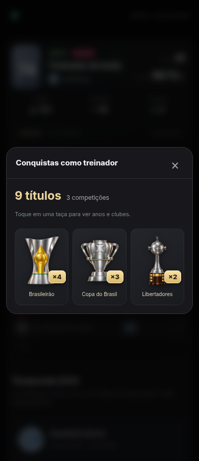

# Conquistas agrupadas por competição

Implementação da proposta aprovada pelo usuário: uma taça por competição com contador ×1, ×2, ×3, etc. Está na branch de continuidade; ainda não foi publicada.

## Apresentação

- A ficha do treinador mostra o total de títulos e o número de competições, com uma taça por competição e nomes curtos.
- A prévia mostra até seis competições e oferece acesso à vitrine completa quando houver mais.
- A janela de conquistas usa três taças por linha no celular. Cada taça tem seu contador dourado e uma área fixa para manter as linhas uniformes.
- Tocar em uma taça abre o histórico, com anos, clubes e contagem por clube. O botão de retorno volta à grade; Escape fecha a janela e restaura o foco no controle de origem.
- As imagens existentes das competições foram preservadas. Não há repetição da taça para cada ano ganho.

## Dados e compatibilidade

O agrupamento é apenas de apresentação: os títulos originais não são regravados nem removidos. Saves antigos com o campo de campeão e saves atuais com listas de títulos mantêm seus totais.

A identidade da competição usa os aliases já empregados pelas imagens. Assim, Libertadores e Copa Libertadores compartilham contador; copas diferentes e divisões de países diferentes não são agrupadas apenas por tipo de troféu. Histórico de temporadas, coleção permanente e celebrações de campeonato permanecem no fluxo existente.

## Validação

24 arquivos de testes de lógica, build de produção e 52 testes de navegador passaram. Os novos testes verificam contagem por competição, aliases, registros antigos, clubes e anos, grade de três colunas, navegação por teclado, retorno de foco e persistência após recarregar.
