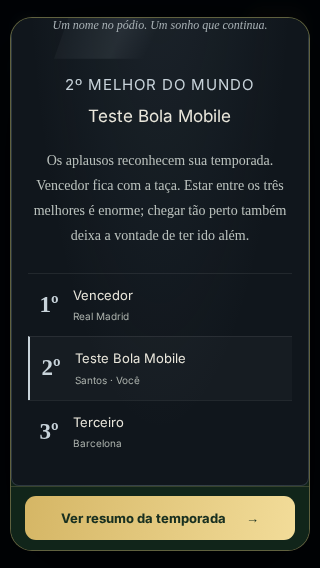
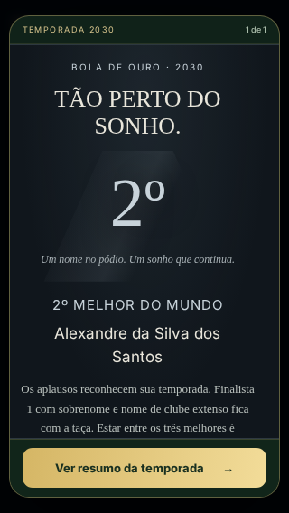

# Bola de Ouro: saída acessível no celular

A cerimônia compartilhada da Bola de Ouro podia superar a altura disponível do diálogo rápido. O diálogo ocultava o excesso, mas o corpo da cerimônia não tinha rolagem própria. O foco automático do navegador podia deslocar o diálogo para o botão, recortando o início, e a navegação pelo conteúdo podia tornar a continuação inacessível.

O diálogo agora usa coluna flexível, cabeçalho e rodapé preservados e corpo com altura mínima zero e rolagem própria. A ação permanece visível em telas pequenas e na orientação horizontal. No modo completo, `JanelaPremiacao` aplica a mesma separação ao conteúdo dos três passos de premiação, mantendo a chamada original de avanço/finalização. Os textos emocionais, pódios e números salvos continuam iguais.

13 testes específicos cobrem rápido/completo, 1º/2º/3º, 320×568 e 844×390: rolar até o fim e voltar ao início sem perder a ação, tocar para avançar/fechar, retornar o foco, liberar a rolagem da página e reabrir a janela. Um save real na etapa antiga `bolaOuro` também retoma, avança pelo resumo e volta à carreira sem repetir gols, assistências, títulos ou temporadas. Mais 30 cenários existentes de cerimônias, museu, modo completo e identidade visual passaram na revisão local.

## Validação final

Validação integral do commit `ffd85b3`: **454 testes de lógica e 336 testes no navegador aprovados**, além do build de produção. [GitHub Actions](https://github.com/bravolucas/A-Joia/actions/runs/42868077049) e [publicação no GitHub Pages](https://github.com/bravolucas/A-Joia/actions/runs/42868076966) concluídos com sucesso.

Conferência pública em https://bravolucas.github.io/A-Joia/: JavaScript principal, CSS e módulo completo idênticos aos arquivos do build testado. Os 278 novos escudos estão no catálogo publicado (250 arquivos com URL própria HTTP 200 e 28 incorporados ao código); as 70 imagens do museu e miniaturas também retornaram HTTP 200.
