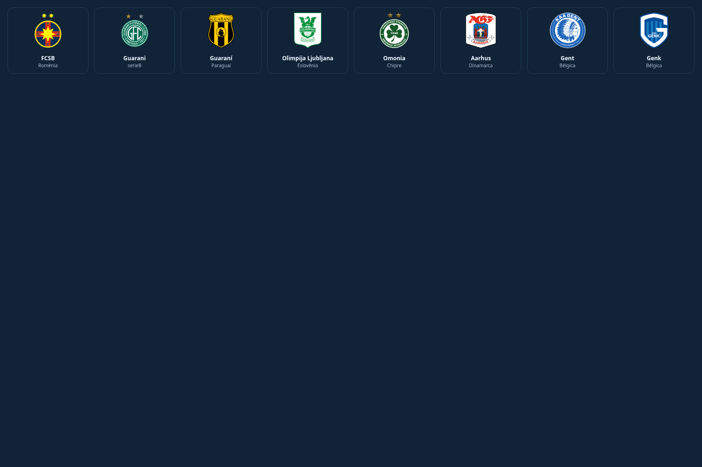
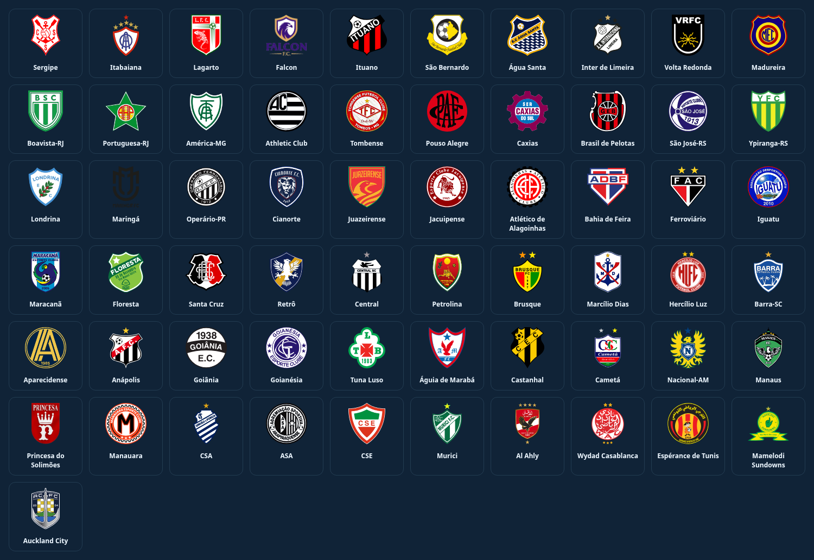

# Escudos completos dos clubes

278 arquivos reais adicionados: 220 para o catálogo internacional e 58 para estaduais/Mundial. A pesquisa cobriu 276 faltas e duas identidades confundidas pela grafia. Os 642 nomes do catálogo atual, incluindo aliases históricos de Hamburgo e Köln, agora resolvem um escudo local.

- Guaraní do Paraguai tem arquivo próprio; Guarani do Brasil mantém o seu.
- Boavista-RJ ganha identificação explícita nos novos estaduais; campanhas regionais antigas com `Boavista` usam o contexto `RJ` para mostrar o escudo brasileiro. Boavista de Portugal permanece separado.
- St Patrick’s Athletic e Connah’s Quay aceitam os apóstrofos tipográficos e comuns.
- Nomes traduzidos foram conferidos por país: Gent/Genk, Omonia/Omonia 29M, Olimpija atual/antecessor, Aarhus/AGF, Estrela Vermelha/Crvena Zvezda e outros.
- Os arquivos originais foram preservados; SVG com conteúdo inadequado para imagens foi substituído por outra fonte. Um contorno de luz na interface melhora a leitura de emblemas escuros sem mudar as cores dos clubes.

O manifesto [do acervo](../../arte/escudos/acervo-adicoes-2026-11-10.json) registra fontes, referências, país, tamanho e SHA-256 dos 278 arquivos. A conferência local carregou todos os 642 nomes no navegador sem imagens ausentes. Testes cobrem nomes ambíguos em celular/desktop, campanha regional antiga, integridade dos originais e os escudos nos confrontos internacionais reais.

Validação local: build de produção aprovado, 21 testes de lógica relacionados e 18 cenários de navegador aprovados. Os cenários incluem o acervo completo, identidades em 320/1366 px, escudos nos confrontos com Bolívar/Panathinaikos, Boavista de campanha regional antiga e os placares das copas. A validação integral e a publicação serão registradas após o GitHub Actions.
