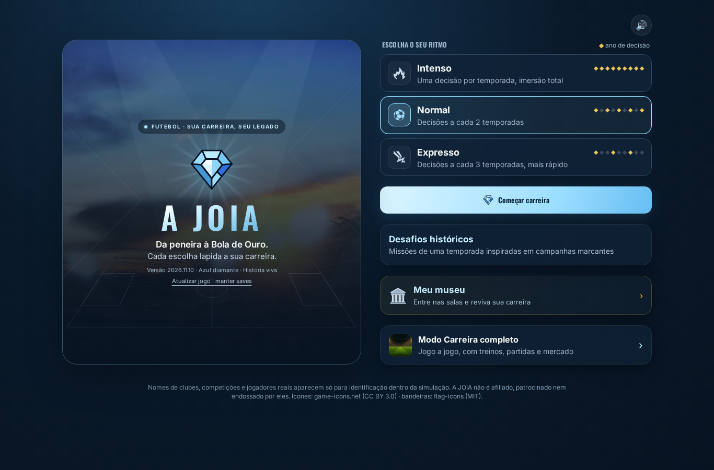
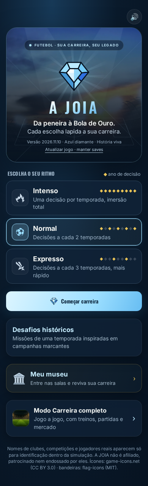
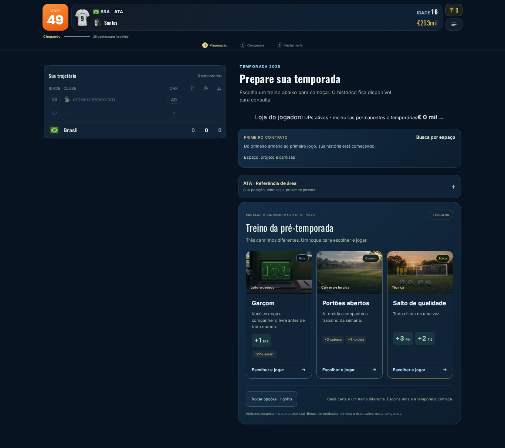

# Azul diamante e movimento — primeira etapa visual

O azul claro do cristal passa a ser a identidade principal da interface, sobre azul profundo. Gema, botões principais, cartões de escolha, foco, apresentações do modo completo e identidade do navegador acompanham a paleta. Cores de clubes, uniformes, gramado e materiais das peças do museu continuam próprias. O ouro permanece nas conquistas. O novo visual é o padrão, preservando visuais explicitamente escolhidos no navegador.

## Movimento aplicado

- Motion for React compartilhado com `LazyMotion`, `domAnimation` e preferência de movimento do sistema.
- Título da marca revelado por palavras, com texto completo para tecnologias assistivas.
- Fachos de estádio e geometria de campo decorativa na abertura, sem canvas/WebGL.
- Luz do cartão acompanha somente mouse; toque e teclado continuam selecionando diretamente.
- Transições de opacidade nas etapas do jogador, abas/etapas do completo e salas/capítulos do museu. O conteúdo não é remontado pelo efeito, evitando reiniciar decisões e minigames. Sem `transform` no ancestral dos elementos fixos.
- Resposta em hover, foco e pressão nos botões/cartões; entrada dos objetos e das janelas de detalhes.
- Movimento reduzido elimina revelações, movimentos de hover e efeitos decorativos; ações não aguardam animações para funcionar. O marcador pequeno de tempo continua ativo, pois informa o momento de executar a jogada.

## Referências e autoria

- [Motion — acessibilidade](https://motion.dev/docs/react-accessibility).
- [React Bits — Blur Text](https://reactbits.dev/text-animations/blur-text).
- [React Bits — Spotlight Card](https://reactbits.dev/components/spotlight-card).

Os componentes `TextoRevelado` e `CartaoLuz` são implementações próprias e enxutas inspiradas nesses padrões do React Bits; não dependem do catálogo completo. As transições usam a biblioteca Motion. A arte fotográfica existente foi reaproveitada sem alteração dos arquivos.

## Capturas

[Vídeo curto dos efeitos e interações](efeitos.webm).

## Validação

Testes de navegador verificam 320/390/1366 px, seleção por mouse/toque, ausência de overflow, movimento reduzido e retomada do save, além da regressão das telas e partidas existentes. Build de produção aprovado; 451 testes de lógica aprovados. A identidade visual passou em oito cenários específicos de navegador, incluindo o marcador essencial com movimento reduzido. Os dois confrontos com adversários extras também passaram, assim como a criação de carreira nos dois tamanhos de tela após remover uma corrida com o avanço automático da apresentação. A validação integral de navegador e a publicação ficam registradas após o GitHub Actions.
